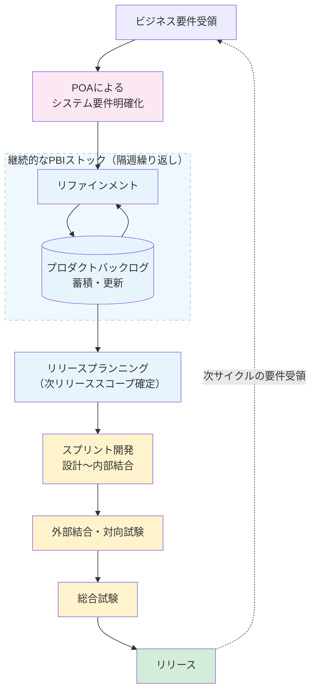

# 【工事中】開発プロセス概要

## 全体フロー

本プロジェクトはアジャイル開発（スクラムベース）を採用し、2スプリント（約4週間）を1リリースサイクルとして繰り返す。

---

## セレモニー詳細

各イベントの運営方法・アジェンダ・チェックリスト等の詳細は個別のイベント定義ページを参照。

| #   | イベント                              | インプット                   | アウトプット                                                                       |
| --- | ------------------------------------- | ---------------------------- | ---------------------------------------------------------------------------------- |
| 0   | POAによるシステム要件明確化           | ビジネス要件                 | PBI Draft                                                                          |
| 1   | リファインメント（1部：代表者会議）   | PBI Draft                    | 優先順位（エピックレベル）・・チーム間連携の認識合わせ・第2部持ち込みPBIの絞り込み |
| 1   | リファインメント（2部：チーム別議論） | 1部の決定内容                | Ready状態のPBI                                                                     |
| 2   | リリースプランニング                  | Ready PBI一覧・キャパシティ  | **次リリース確定スコープ**・持ち越しリスト                                         |
| 3   | スプリント開発（設計〜内部結合）      | 確定スコープ                 | 内部結合済み成果物                                                                 |
| 4   | 外部結合・対向試験                    | 内部結合済み成果物・IF仕様書 | 外部結合試験エビデンス                                                             |
| 5   | 総合試験                              | 外部結合試験エビデンス       | 総合試験エビデンス・リリース判定                                                   |
| 6   | リリース                              | 総合試験エビデンス           | 商用環境への反映                                                                   |

スケジュール・日程の詳細は[リリースサイクル](./release-cycle.md)を参照。
