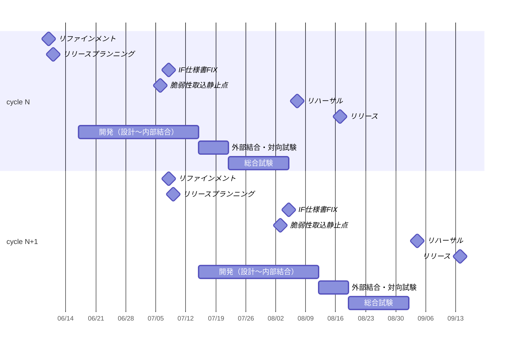

# 【工事中】リリースサイクル

## 基本方針

- リリースサイクルは2スプリントを1単位とする
- リファインメントで継続的にPBIをReady化しておき、リリースプランニングではReadyなPBIの中から優先度順に次リリースのスコープを確定する
- リファインメントは隔週水曜に実施し、リリースサイクル開始前の木曜日にリリースプランニングでスコープを確定する
- リリースは原則、総合試験完了後の最初の月曜日に実施するが、主管部の要望や祝日等により、上記と異なるサイクル・リリース日を設定する場合がある
- リリースプランニングでスコープ超過した要件（Readyではあるが優先度上積みきれなかったPBI）は次サイクルに持ち越す（例: cycle N で超過 → cycle N＋1 でリリース。優先度が低い場合はさらに持ち越す可能性もある。）

## 規模目安

ビジネス要件を受領した時点で、その規模に応じてどのリリースサイクルでのリリースを見込めるかの目安を以下に示す。

| 規模 | 規模の判定基準                                                          | リリースまでの目安                                                          |
| ---- | ----------------------------------------------------------------------- | --------------------------------------------------------------------------- |
| 大   | 複数チームにまたがる依存があり、2Sprint を超える規模                    | 受領から **約3.5〜4ヶ月後** （Cycle N で受領 → Cycle N＋1 でリリース） |
| 中   | チーム内で対応可能な中大規模、または小中規模な2チーム程度にまたがる規模 | 受領から **約2.5〜3ヶ月後** （Cycle N で受領 → Cycle N でリリース）    |
| 小   | hotfix（プロンプトチューニング、モデル差し替え等）                      | 受領後 **直近の hotfix 枠、または直近サイクル内**                           |

## マイルストーン・期間

> 以下は cycle N を例としたスケジュールで、以降のサイクルも同様のパターンで繰り返す。

リリースサイクル内で管理するマイルストーン（点）と活動（期間）を、時系列順にまとめて定義する。

> **注記**: マイルストーンの期限は **営業日（土日・祝日除く）** で表記している。活動の所要期間はカレンダー日数（土日含む）と営業日換算の両方を記載している。

| 項目                   | 種別           | 期限・所要期間                                    | 開始基準・備考                                                           |
| ---------------------- | -------------- | ------------------------------------------------- | ------------------------------------------------------------------------ |
| リファインメント       | マイルストーン | 開発開始の **5営業日前（1週間前）を含む週の水曜** | -                                                                        |
| リリースプランニング   | マイルストーン | リファインメントの **翌営業日（木曜）**           | -                                                                        |
| 開発（設計〜内部結合） | 活動           | **28カレンダー日（約20営業日）**                  | 設計〜内部結合試験（ITa）                                                |
| IF仕様書FIX            | マイルストーン | 開発完了の **4営業日前**                          | IF仕様書（インターフェース仕様書）の確定日                               |
| 脆弱性取り込み静止点   | マイルストーン | 開発完了の **6営業日前**                          | 脆弱性情報の取り込みを凍結する基準日。以降公開の脆弱性は当サイクル対象外 |
| 外部結合・対向試験     | 活動           | **7カレンダー日（約5営業日）**                    | 外部結合試験（ITb）、対向試験を含む                                      |
| 総合試験               | 活動           | **14カレンダー日（約10営業日）**                  | 外部結合・対向試験完了後から開始                                         |
| リハーサル             | マイルストーン | リリース日の **6営業日前**                        | -                                                                        |
| リリース               | マイルストーン | リリース日（月曜）                                | 商用環境への反映                                                         |
