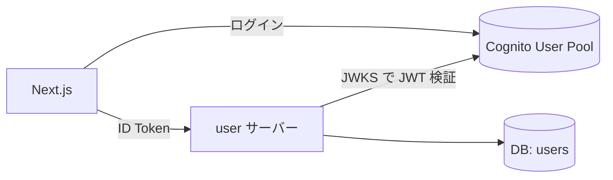

# アーキテクチャ

## 構成

## 認証・認可

- ログインは Cognito が行い、フロントは ID Token を `Authorization: Bearer` で送る。
- API 側で署名（JWKS）・`iss`・`aud`・`exp` を検証する。
- ユーザーは JWT の `sub` で特定する（クライアントから ID を受け取らない）。

## 初回登録フロー

1. Cognito でサインアップ・ログイン
2. フロントが `GET /api/me` を呼ぶ
3. 404 の場合、`POST /api/me` で初回登録（A0102）
4. 以降は A0101 でプロフィール取得
