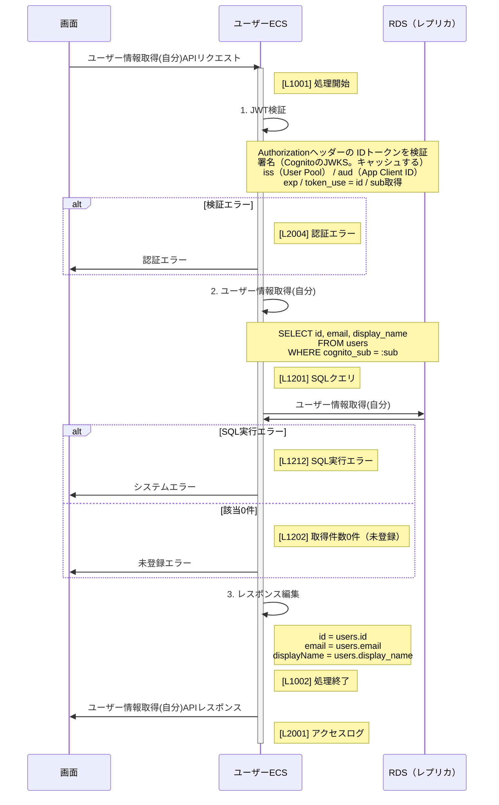

# A0101 ユーザー情報取得(自分)

## 概要

ログイン中のユーザー自身のプロフィールをユーザー情報から取得する。ユーザーは ID トークンの `sub` で特定する。

## シーケンス図

- `sub`、`email`、トークンなどの個人情報・認証情報はログに出力しない。

## 参考資料

- [IF仕様書](pathname:///redoc/user.html#operation/getMe)
- [ログ一覧](../../../30_common-design/logging/log-catalog.md)
- [アーキテクチャ](../architecture.md)
